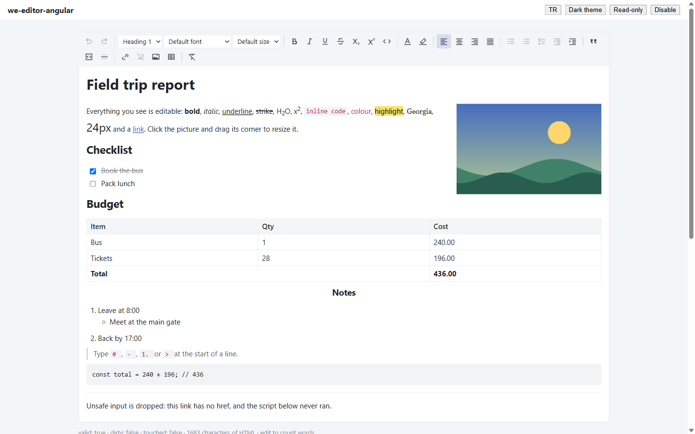

# we-editor-angular

[](https://www.npmjs.com/package/we-editor-angular)
[](https://github.com/emrecirik/we-editor/actions/workflows/ci.yml)
[](LICENSE)
[](https://angular.dev)
[](docs/localization.md)

[English](README.md)



**Canlı deneyin:** [we-editor Studio](https://emrecirik.github.io/we-editor/studio/) — editör Türkçe ya da İngilizce, açık ya da koyu temada, güvenli HTML gidiş-dönüşüyle.

Angular için ücretsiz, temalanabilir zengin metin editörü; [ProseMirror](https://prosemirror.net)
üzerine kurulu. CSS framework'ü, ikon fontu veya ticari bağımlılık yok.
[we-grid-angular](https://github.com/emrecirik/we-grid)'ın kardeş paketi.

> **Durum: 0.2.0.** Yol haritası Word düzeyinde belgeler,
> hesap tablosu tabloları, tasarım/kod/bölünmüş HTML editörü ve mail-merge şablonlarına uzanıyor —
> bkz. [docs/ROADMAP.md](docs/ROADMAP.md).

## Özellikler

- `<we-editor>` standalone bileşen, bir **form kontrolü** (`formControlName`, `[formControl]`,
  `ngModel`); değeri HTML metnidir, boşken `''` olur, böylece `Validators.required` çalışır
- Kalın, italik, altı çizili, üstü çizili, alt simge, üst simge, satır içi kod
- Paragraf ve H1–H6 başlıklar, yazı tipi, yazı boyutu
- Metin rengi ve vurgu için **renk paleti**: hazır renkler, özel renk, rengi kaldır, son kullanılanlar
- Sola / ortaya / sağa hizalama, iki yana yasla, girinti artır / azalt
- Madde işaretli, numaralı ve görev listeleri (Tab / Shift+Tab ile iç içe, tıklanabilir onay kutuları)
- Alıntı, kod bloğu, yatay çizgi, bağlantılar ("yeni sekmede aç" seçeneğiyle), biçimi temizle
- **Tablolar:** istenen boyutta ekleme, satır/kolon ekleme-silme, hücre birleştirme/bölme, başlık
  satırı/kolonu, sürükleyerek kolon genişliği
- **Resimler:** adres, yükleme, yapıştırma ya da sürükle-bırak; boyutlandırma tutamacı, sola/sağa
  yaslama, ortalama, alternatif metin; kendi yükleme servisiniz (`imageUpload`)
- İzin listeli **YouTube / Vimeo** gömme
- **Bul ve değiştir** (Ctrl/Cmd+F): büyük/küçük harf, tam kelime, tümünü değiştir
- **Özel karakter ve emoji** seçici
- Markdown kısayolları (`# `, `- `, `1. `, `> `, ```` ``` ````), yazılan ve yapıştırılan adresler için otomatik bağlantı
- Yer tutucu metin, kelime ve karakter sayısı (`stats` çıktısı), geri al / yinele, klavye kısayolları
- **Güvenli HTML giriş ve çıkışı:** belge şeması izin listesidir — script'ler, olay işleyicileri,
  `javascript:` bağlantıları ve güvensiz CSS değerleri atılır; `weEditorSanitizeHtml()` editörsüz
  kullanım için de dışa açıktır
- CSS custom property ile açık/koyu tema; Türkçe, İngilizce, Almanca, Fransızca ve İspanyolca arayüz; satır içi SVG ikonlar

## Kurulum

```bash
npm install we-editor-angular
```

`angular.json` → `styles` içine varsayılan temayı ekleyin:

```json
"node_modules/we-editor-angular/styles/we-editor-theme.scss"
```

## Kullanım

```ts
import { WeEditorComponent, WE_EDITOR_LOCALE, weEditorLocaleTr } from 'we-editor-angular';

@Component({
  standalone: true,
  imports: [WeEditorComponent, ReactiveFormsModule],
  providers: [{ provide: WE_EDITOR_LOCALE, useValue: weEditorLocaleTr }],
  template: `<we-editor [formControl]="govde" />`
})
export class EpostaComponent {
  govde = new FormControl('<p>Merhaba</p>', { nonNullable: true });
}
```

## Dokümanlar

[API](docs/api.md) · [Tema](docs/theming.md) · [Yerelleştirme](docs/localization.md) ·
[Mimari](docs/ARCHITECTURE.md) · [Yol haritası](docs/ROADMAP.md) · [Lisanslar](docs/LICENSES.md)

## Lisans

MIT © Emre CIRIK.
