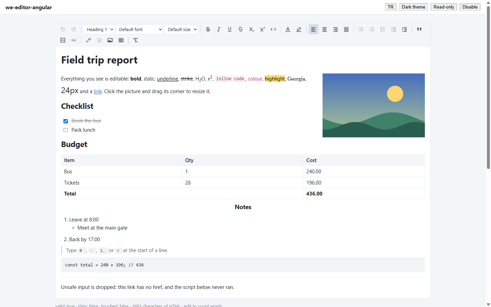

# we-editor-angular

[](https://www.npmjs.com/package/we-editor-angular)
[](https://github.com/emrecirik/we-editor/actions/workflows/ci.yml)
[](https://github.com/emrecirik/we-editor/blob/main/LICENSE)
[](https://angular.dev)
[](https://github.com/emrecirik/we-editor/blob/main/docs/localization.md)
[](https://github.com/emrecirik/we-editor/blob/main/docs/theming.md)

[Türkçe](https://github.com/emrecirik/we-editor/blob/main/README.tr.md)



**Try it live:** [we-editor Studio](https://emrecirik.github.io/we-editor/studio/) — the editor in English or Turkish, light or dark, with the safe-HTML round trip.

A free, themeable rich-text editor for Angular, built on [ProseMirror](https://prosemirror.net).
No CSS framework, no icon font, no commercial dependency. A sibling of
[we-grid-angular](https://github.com/emrecirik/we-grid).

> **Status: 0.4.0.** The roadmap goes on to Word-level documents,
> spreadsheet tables, a design/code/split HTML editor and mail-merge templates — see
> [docs/ROADMAP.md](https://github.com/emrecirik/we-editor/blob/main/docs/ROADMAP.md).

## Features

- `<we-editor>` standalone component, a **form control** (`formControlName`, `[formControl]`,
  `ngModel`) whose value is an HTML string; `''` when empty so `Validators.required` works
- Bold, italic, underline, strikethrough, subscript, superscript, inline code
- Paragraph and headings H1–H6, font family, font size
- **Colour palette** for text colour and highlight: swatches, custom colour, remove colour, recent colours
- Align left / centre / right / justify, indent / outdent
- Bulleted, numbered and task lists (nest with Tab / Shift+Tab, clickable checkboxes)
- Quote, code block, horizontal line, links (with "open in new tab"), clear formatting
- **Tables:** insert any size, add/delete rows and columns, merge/split cells, header row/column,
  drag to resize columns
- **Images:** URL, upload, paste or drag-and-drop; resize handle, float left/right, centre, alt text;
  plug in your own upload endpoint (`imageUpload`)
- **YouTube / Vimeo** embeds with an iframe allowlist
- **Find & replace** (Ctrl/Cmd+F) with match case, whole words, replace all
- **Special characters and emoji** picker
- **HTML source view** (CodeMirror 6, loaded on demand): code view or split view with live two-way sync, format button
- **Code blocks with syntax highlighting** in 23 languages
- **Paste from Word / Google Docs:** Word lists become real nested lists, Office style noise is removed
- **Format painter**, **change case** (language-aware: Turkish İ/ı), **line height** — premium-only elsewhere
- **Status bar** with a clickable element path (`table › tr › td › p`) and counts; **full screen**; **autosave** hook
- Markdown shortcuts (`# `, `- `, `1. `, `> `, ```` ``` ````), autolink for typed and pasted URLs
- Placeholder, word and character counts (`stats` output), undo / redo, keyboard shortcuts
- **Safe HTML in and out:** the document schema is the allowlist — scripts, event handlers,
  `javascript:` links and unsafe CSS values are dropped; `weEditorSanitizeHtml()` is exported for use
  without an editor
- Light and dark theme through CSS custom properties; English, Turkish, German, French and Spanish UI; inline SVG icons

## Install

```bash
npm install we-editor-angular
```

Add the default theme to `angular.json` → `styles`:

```json
"node_modules/we-editor-angular/styles/we-editor-theme.scss"
```

## Use

```ts
import { Component } from '@angular/core';
import { FormControl, ReactiveFormsModule } from '@angular/forms';
import { WeEditorComponent } from 'we-editor-angular';

@Component({
  selector: 'app-mail',
  standalone: true,
  imports: [WeEditorComponent, ReactiveFormsModule],
  template: `<we-editor [formControl]="body" />`
})
export class MailComponent {
  body = new FormControl('<p>Hello <strong>world</strong></p>', { nonNullable: true });
}
```

Turkish UI: `providers: [{ provide: WE_EDITOR_LOCALE, useValue: weEditorLocaleTr }]`.

## Docs

[API](https://github.com/emrecirik/we-editor/blob/main/docs/api.md) · [Theming](https://github.com/emrecirik/we-editor/blob/main/docs/theming.md) · [Localization](https://github.com/emrecirik/we-editor/blob/main/docs/localization.md) ·
[Architecture](https://github.com/emrecirik/we-editor/blob/main/docs/ARCHITECTURE.md) · [Roadmap](https://github.com/emrecirik/we-editor/blob/main/docs/ROADMAP.md) · [Licences](https://github.com/emrecirik/we-editor/blob/main/docs/LICENSES.md)

## Compatibility

Angular 18.2 – 22 from a single build (proved by the `compat` workflow). Works with and without
zone.js.

## License

MIT © Emre CIRIK. Third-party licences: [docs/LICENSES.md](https://github.com/emrecirik/we-editor/blob/main/docs/LICENSES.md).
